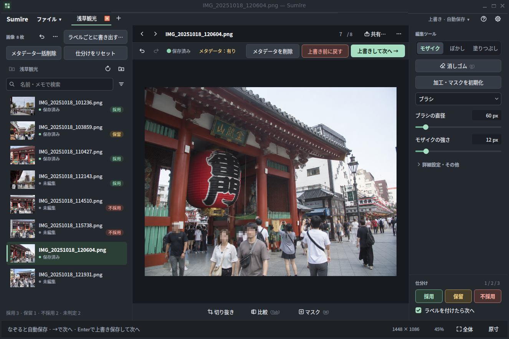

# Sumīre — image finishing

[](CHANGELOG.md) [](https://github.com/marc2825/Sumire-image-editor/actions/workflows/tests.yml) [](LICENSE) [](README-Windows.en.txt)

[日本語](README.md) · English · [简体中文](README.zh-CN.md)

<p align="center"></p>
<p align="center"><sub>(* These are fictional photos generated by AI.)</sub></p>

Sumīre is a Windows 11 app for hiding parts of images with mosaic or blur, and for viewing and removing their metadata. It also helps you sort and export large batches of images. All image processing happens on your PC.

It is mainly meant for sorting and mosaicking large batches of photos taken at events or sightseeing spots, and of illustrations generated in bulk with AI.

## The basic flow

Open a folder, trace over what you want to hide, and press → for the next image. Edits are saved automatically; Enter saves and moves on.

On the first start, choose where to save: overwrite the originals, or save to a separate folder.

## Features

- **Hide**: mosaic, blur and fill, with a brush, rectangle, ellipse, polygon or lasso. Eraser, undo / redo and comparison with the original.
- **View and remove metadata**: see EXIF, PNG text, generation prompts and more as a list, and remove them one image at a time or in bulk. NovelAI's information embedded in transparency (Stealth PNGInfo) and the C2PA Content Credentials added by image generators such as ChatGPT are removed too, and the saved file is checked. By default, metadata is kept when saving.
- **Restore later**: metadata removed from an image can be kept and restored into a separate copy.
- **Sort**: Accept / Hold / Reject labels (and sorting into a folder per label, also automatically as you label), free-form tags, filters, tabs, moving between folders, numbered renaming, duplicate removal and side-by-side comparison.
- **Export**: convert to PNG, JPEG, WebP, AVIF, BMP, TIFF or GIF, reduce file size, make collages.
- **Adjust**: crop, resize, rotate, flip, colour (brightness, contrast, saturation, hue, exposure, temperature and more), upscale.
- **Share**: hand images without metadata to NovelAI's Image2Image or to other apps.

The interface is available in Japanese, English and Simplified Chinese (at the bottom right of the start page, or Settings → Display and import → Language).

Sumīre makes no network requests. It only opens your default browser for NovelAI.

## Getting started

**Windows**: extract the whole distribution ZIP and run `sumire.exe`. Python is not needed. See [README-Windows.en.txt](README-Windows.en.txt).

**From source**: install Python 3.12 or later and run this in the project folder:

```powershell
py -3.12 -m venv .venv
.\.venv\Scripts\python.exe -m pip install -e ".[dev]"
.\.venv\Scripts\python.exe -m sumire
```

**From WSL (Ubuntu 24.04)**: install the libraries Qt uses, then run this in the project folder:

```bash
sudo apt install python3-venv libegl1 libgl1 libfontconfig1 libdbus-1-3 libglib2.0-0 \
  libxkbcommon0 libwayland-client0 libwayland-cursor0 libwayland-egl1 \
  libx11-xcb1 libxkbcommon-x11-0 libxcb-cursor0 libxcb-glx0 libxcb-icccm4 libxcb-image0 libxcb-keysyms1 \
  libxcb-randr0 libxcb-render-util0 libxcb-shape0 libxcb-shm0 libxcb-sync1 libxcb-xfixes0 libxcb-xkb1
python3 -m venv .venv
.venv/bin/python -m pip install -e ".[dev]"
.venv/bin/python -m sumire
```

Open Windows folders as `/mnt/c/Users/<name>/Pictures` (reading and writing there is slower than inside WSL). To add “Open with Sumīre” to the right-click menu from Settings → Windows, also install Python for Windows (it is used to start the Sumīre in WSL).

Running on Linux, tests and building the exe are described in [Development and builds](docs/DEVELOPMENT.md) (Japanese).

## Before you share

- **An overwritten original cannot be brought back after the app closes.** Until then, “⋯ → Restore the original from before overwriting” brings it back. To keep originals, save to a separate folder.
- **Metadata kept for restoring is not encrypted.** Prompts and location data stay readable; they are stored in the app's own data folder. Installations from 0.4.0 or earlier keep them as `.sumire-index.sqlite3` in the image folder; leave that file out when sharing whole folders.
- **Mosaic and blur cannot hide completely.** Use fill at 100% opacity for anything that must stay hidden.
- **“Metadata: none” covers the kinds Sumīre checks.** It cannot detect unknown embedding methods or text drawn into the image.
- **Sumīre is not meant to promote or encourage copyright infringement with AI-generated illustrations.** When you use or publish images, **respect copyright and other rights, and the rules of the sites you post to.**

See [Saving and privacy](docs/en/SAVING_AND_PRIVACY.md) for details.

## Documentation

Press “?” or F1 in the app to read the same help offline.

| Document | Contents |
| --- | --- |
| [Features](sumire/help_docs/en/FEATURES.md) | What Sumīre can do, and where |
| [Getting started](sumire/help_docs/en/USER_GUIDE.md) | Opening, hiding, saving and sorting, step by step |
| [Shortcuts](sumire/help_docs/en/SHORTCUTS.md) | Keyboard shortcuts |
| [Metadata and restoring](sumire/help_docs/en/METADATA.md) | Removing, keeping and restoring, and what to watch when sharing |
| [FAQ](sumire/help_docs/en/FAQ.md) | When something goes wrong |
| [Usage guide](docs/en/USAGE.md) | Every feature in detail |
| [Saving and privacy](docs/en/SAVING_AND_PRIVACY.md) | How saving works, what is checked, and the limits |
| [Security](docs/en/SECURITY.md) / [Reporting problems](docs/en/CONTRIBUTING.md) | How to report |

The change log, roadmap, development notes and technical explanations are in Japanese.

## License

Sumīre's code is under the [MIT License](LICENSE): you may modify, redistribute and use it commercially.

Python, Qt, PySide6, Pillow, Noto Sans JP and the other parts of the Windows version keep their own licences (LGPLv3 for Qt and PySide6, SIL Open Font License 1.1 for Noto Sans JP, and so on). See [THIRD_PARTY_NOTICES.md](THIRD_PARTY_NOTICES.md) (Japanese) for the list and [QT_REPLACEMENT.md](QT_REPLACEMENT.md) for replacing Qt and getting its source.

\* Most of the documentation, including this README, is based on text generated by AI.
