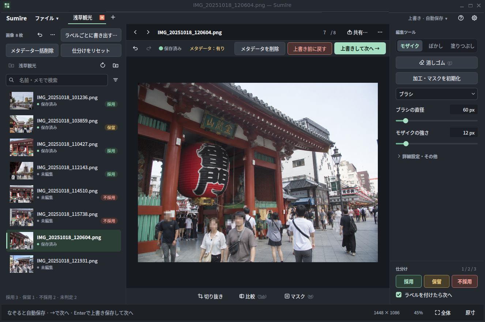

# Sumīre — 画像の仕上げ

[](CHANGELOG.md) [](https://github.com/marc2825/Sumire-image-editor/actions/workflows/tests.yml) [](LICENSE) [](README-Windows.txt)


[English](README.en.md) · [简体中文](README.zh-CN.md)

<p align="center"></p>
<p align="center"><sub>（※ これらはAIによって生成された架空の写真です。）</sub></p>


画像の一部をモザイクやぼかしで隠したり、メタデータを確認・削除したりできる、Windows 11向けのアプリです。大量の画像の仕分けや書き出しにも使えます。画像の処理はすべてPC内で行います。

主にイベントや観光地で大量に撮影した写真や、AIで大量生成したイラストの選別・モザイク入れに使用することを想定しております。

## 基本の流れ

1. フォルダーを開く
2. 隠したい部分をなぞる（自動で保存されます）
3. →キーで次の画像へ（Enterで保存して次へ）

元画像に上書きするか、別フォルダーに保存するかは、初回の起動時に選びます。

## できること

- モザイク・ぼかし・塗りつぶしで隠す（ブラシ・長方形・楕円・多角形・投げ縄）
- メタデータの確認・削除・復元（NovelAIのStealth PNGInfo、ChatGPTなどのC2PAにも対応）
- 採用・保留・不採用のラベルとタグで仕分け、ラベルごとのフォルダーへ振り分け
- 作業タブ、フォルダー間の移動、連番での名前変更、重複の削除、複数枚の比較
- 形式の変換、容量削減、コラージュ
- 切り抜き・回転・色調の調整・超解像
- メタデータを除いて、NovelAIやほかのアプリへ渡す

表示言語は日本語・英語・簡体字中国語です。通信はせず、NovelAIを開くときだけ既定のブラウザーを使います。

## 使い始める

### Windows版

配布ZIPをすべて展開し、`sumire.exe` を起動します。Pythonは要りません。詳しくは[README-Windows.txt](README-Windows.txt)をご覧ください。

### ソースから

Python 3.12以降を入れて、プロジェクトのフォルダーで実行します。

```powershell
py -3.12 -m venv .venv
.\.venv\Scripts\python.exe -m pip install -e ".[dev]"
.\.venv\Scripts\python.exe -m sumire
```

### WSL（Ubuntu 24.04）

Qtが使うライブラリーを入れてから実行します。

```bash
sudo apt install python3-venv libegl1 libgl1 libfontconfig1 libdbus-1-3 libglib2.0-0 \
  libxkbcommon0 libwayland-client0 libwayland-cursor0 libwayland-egl1 \
  libx11-xcb1 libxkbcommon-x11-0 libxcb-cursor0 libxcb-glx0 libxcb-icccm4 libxcb-image0 libxcb-keysyms1 \
  libxcb-randr0 libxcb-render-util0 libxcb-shape0 libxcb-shm0 libxcb-sync1 libxcb-xfixes0 libxcb-xkb1
python3 -m venv .venv
.venv/bin/python -m pip install -e ".[dev]"
.venv/bin/python -m sumire
```

- Windowsのフォルダーは `/mnt/c/Users/<name>/Pictures` のように開けます（WSL内より読み書きが遅くなります）。
- 右クリックに「Sumīreで開く」を加えるには、Windows版のPythonも必要です。

テストやexeの作り方は[開発・ビルド](docs/DEVELOPMENT.md)にあります。

## 注意

- 上書きした元画像は、アプリを終了すると戻せません。元画像を残すときは、別フォルダーに保存してください。
- 初期設定では、保存してもメタデータは残ります。消すときは「メタデータを削除」を使います。
- 復元用に残したメタデータは暗号化していません（プロンプトや位置情報も読める状態です）。
- モザイクやぼかしでは完全には隠せません。確実に隠す部分は、不透明度100%で塗りつぶしてください。
- 「メタデータ：無し」は、対応している種類を調べた結果です。未知の方法で埋め込まれた情報や、画像に描かれた文字は調べられません。
- Sumīreは、AI生成イラストによる著作権の侵害を推進・助長するものではありません。画像を使う・公開するときは、著作権などの権利と、投稿先の規約を守ってください。

詳しくは[保存とプライバシー](docs/SAVING_AND_PRIVACY.md)をご覧ください。

## 説明書

アプリの「？」かF1で、次のヘルプをオフラインで読めます。

- [機能一覧](sumire/help_docs/FEATURES.md)
- [はじめての操作](sumire/help_docs/USER_GUIDE.md)
- [ショートカット](sumire/help_docs/SHORTCUTS.md)
- [メタデータ・復元](sumire/help_docs/METADATA.md)
- [よくある質問](sumire/help_docs/FAQ.md)

詳しい資料：

- [操作ガイド](docs/USAGE.md)：各機能の詳しい説明
- [保存とプライバシー](docs/SAVING_AND_PRIVACY.md)：保存の仕組み、確かめていること、限界
- [仕組みの解説](docs/technical/README.md)：超解像・モザイク・Stealth PNGInfo・重複の判定
- [開発・ビルド](docs/DEVELOPMENT.md)・[動作確認](docs/VALIDATION_SUMMARY.md)：開発者向け
- [変更履歴](CHANGELOG.md)・[開発計画](ROADMAP.md)
- [不具合の報告・要望](CONTRIBUTING.md)・[セキュリティ](SECURITY.md)

## ライセンス

Sumīreのコードは[MIT License](LICENSE)です。改変・再配布・商用利用ができます。

Windows版に入っているPython・Qt・PySide6・Pillow・Noto Sans JPなどは、それぞれのライセンス（QtとPySide6はLGPLv3、Noto Sans JPはSIL Open Font License 1.1など）に従います。

- 一覧：[THIRD_PARTY_NOTICES.md](THIRD_PARTY_NOTICES.md)
- Qtの差し替え方法とソースの入手方法：[QT_REPLACEMENT.md](QT_REPLACEMENT.md)

※ このREADMEを含め、ドキュメントの大半はAIが生成した文章をもとにしています。
