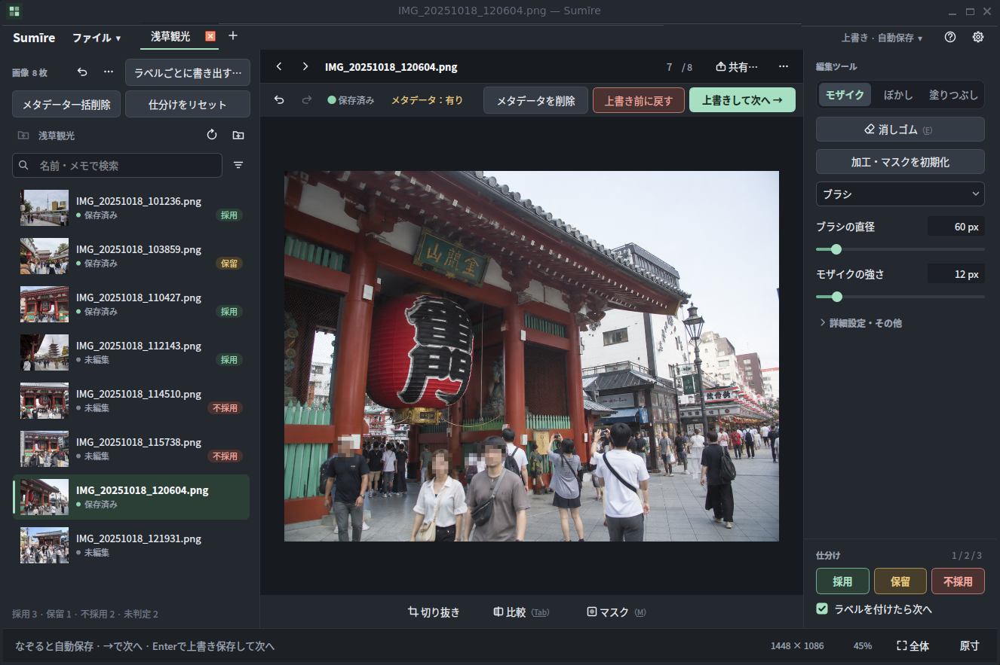

# Sumīre — 图像修整

[](CHANGELOG.md) [](https://github.com/marc2825/Sumire-image-editor/actions/workflows/tests.yml) [](LICENSE) [](README-Windows.zh-CN.txt)

[日本語](README.md) · [English](README.en.md) · 简体中文

<p align="center"></p>
<p align="center"><sub>（※ 这些是由 AI 生成的虚构照片。）</sub></p>

Sumīre 是一款适用于 Windows 11 的应用，可以用马赛克或模糊隐藏图像的一部分，并查看、删除图像的元数据。也可用于大量图像的分拣和导出。所有图像处理都在本机进行。

主要用于对在活动或旅游景点大量拍摄的照片、以及用 AI 批量生成的插画进行筛选和打马赛克。

## 基本流程

打开文件夹，涂抹要隐藏的部分，按 → 键前往下一张图像。加工会自动保存。按 Enter 可保存并前往下一张。

保存位置（覆盖原图，或保存到其他文件夹）在首次启动时选择。

## 功能

- **隐藏**：马赛克、模糊、填充。除画笔外，还可用矩形、椭圆、多边形、套索指定范围。支持橡皮擦、撤销 / 重做以及与原图比较。
- **查看与删除元数据**：以列表查看 EXIF、PNG 文本、生成提示词等，可逐张或批量删除。NovelAI 嵌入透明度中的信息（Stealth PNGInfo）和 ChatGPT 等图像生成 AI 添加的 C2PA（内容凭证）也会删除，并确认没有残留。默认情况下，保存时会保留元数据。
- **之后恢复**：可保留删除前的元数据，恢复到另存的副本中。
- **分拣**：采用、待定、不采用标签（按标签分入文件夹，也可在设置标签时自动移入）、自由标记、筛选、工作标签页、文件夹间移动、编号重命名、删除重复、多张比较。
- **导出**：转换格式（PNG、JPEG、WebP、AVIF、BMP、TIFF、GIF）、压缩体积、拼贴。
- **调整**：裁剪、调整尺寸、旋转、翻转、色调（亮度、对比度、饱和度、色相、曝光、色温等）、超分辨率放大。
- **分享**：将不含元数据的图像交给 NovelAI 的 Image2Image 或其他应用。

界面支持日语、英语和简体中文（初始界面右下角，或设置 → 显示、导入 → 显示语言）。

本应用不进行网络通信。仅在使用 NovelAI 时打开默认浏览器。

## 开始使用

**Windows 版**：解压完整的发行 ZIP，运行 `sumire.exe`。无需 Python。详见 [README-Windows.zh-CN.txt](README-Windows.zh-CN.txt)。

**从源代码运行**：安装 Python 3.12 或更高版本，在项目文件夹中执行：

```powershell
py -3.12 -m venv .venv
.\.venv\Scripts\python.exe -m pip install -e ".[dev]"
.\.venv\Scripts\python.exe -m sumire
```

**从 WSL（Ubuntu 24.04）运行**：先安装 Qt 所需的库，再在项目文件夹中执行：

```bash
sudo apt install python3-venv libegl1 libgl1 libfontconfig1 libdbus-1-3 libglib2.0-0 \
  libxkbcommon0 libwayland-client0 libwayland-cursor0 libwayland-egl1 \
  libx11-xcb1 libxkbcommon-x11-0 libxcb-cursor0 libxcb-glx0 libxcb-icccm4 libxcb-image0 libxcb-keysyms1 \
  libxcb-randr0 libxcb-render-util0 libxcb-shape0 libxcb-shm0 libxcb-sync1 libxcb-xfixes0 libxcb-xkb1
python3 -m venv .venv
.venv/bin/python -m pip install -e ".[dev]"
.venv/bin/python -m sumire
```

Windows 的文件夹可通过 `/mnt/c/Users/<name>/Pictures` 打开（读写比 WSL 内的文件夹慢）。要在设置的“Windows 联动”中把“用 Sumīre 打开”加入右键菜单，还需安装 Windows 版 Python（用于启动 WSL 中的 Sumīre）。

在 Linux 上运行、测试以及制作 exe 的方法见[开发与构建](docs/DEVELOPMENT.md)（日语）。

## 注意事项

- **覆盖保存的原图在应用退出后无法恢复。** 退出前可通过“⋯ → 恢复覆盖前的原图”恢复。如需保留原图，请保存到其他文件夹。
- **为恢复而保留的元数据没有加密。** 提示词和位置信息仍可读取，保存在应用专用位置。从 0.4.0 或更早版本开始使用时，它们位于图像文件夹内的 `.sumire-index.sqlite3`，分享整个文件夹时请排除该文件。
- **马赛克和模糊无法完全隐藏。** 需要确实隐藏的部分，请使用不透明度 100% 的填充。
- **“元数据：无”是对所支持类型的检查结果。** 以未知方式嵌入的信息或图像中绘制的文字无法检查。
- **Sumīre 无意推动或助长利用 AI 生成插画侵犯著作权的行为。** 使用或发布图像时，**请遵守著作权等权利以及发布平台的规定。**

详见[保存与隐私](docs/zh-CN/SAVING_AND_PRIVACY.md)。

## 文档

在应用中按“？”或 F1，可离线阅读相同内容的帮助。

| 文档 | 内容 |
| --- | --- |
| [功能一览](sumire/help_docs/zh_CN/FEATURES.md) | 可以做的事情及其位置 |
| [入门操作](sumire/help_docs/zh_CN/USER_GUIDE.md) | 打开、隐藏、保存、分拣的步骤 |
| [快捷键](sumire/help_docs/zh_CN/SHORTCUTS.md) | 按键操作 |
| [元数据与恢复](sumire/help_docs/zh_CN/METADATA.md) | 删除、保留、恢复以及分享时的注意事项 |
| [常见问题](sumire/help_docs/zh_CN/FAQ.md) | 遇到问题时 |
| [操作指南](docs/zh-CN/USAGE.md) | 各功能的详细说明 |
| [保存与隐私](docs/zh-CN/SAVING_AND_PRIVACY.md) | 保存的机制、检查的内容和限制 |
| [安全](docs/zh-CN/SECURITY.md) / [问题报告](docs/zh-CN/CONTRIBUTING.md) | 报告方法 |

更新记录、开发计划、开发说明和原理说明为日语。

## 许可证

Sumīre 的代码采用 [MIT License](LICENSE)，可以修改、再发布和商业使用。

Windows 版中的 Python、Qt、PySide6、Pillow、Noto Sans JP 等遵循各自的许可证（Qt 和 PySide6 为 LGPLv3，Noto Sans JP 为 SIL Open Font License 1.1 等）。列表见 [THIRD_PARTY_NOTICES.md](THIRD_PARTY_NOTICES.md)（日语），Qt 的替换方法和源代码获取方法见 [QT_REPLACEMENT.md](QT_REPLACEMENT.md)。

※ 包括本 README 在内，大部分文档以 AI 生成的文字为基础。
